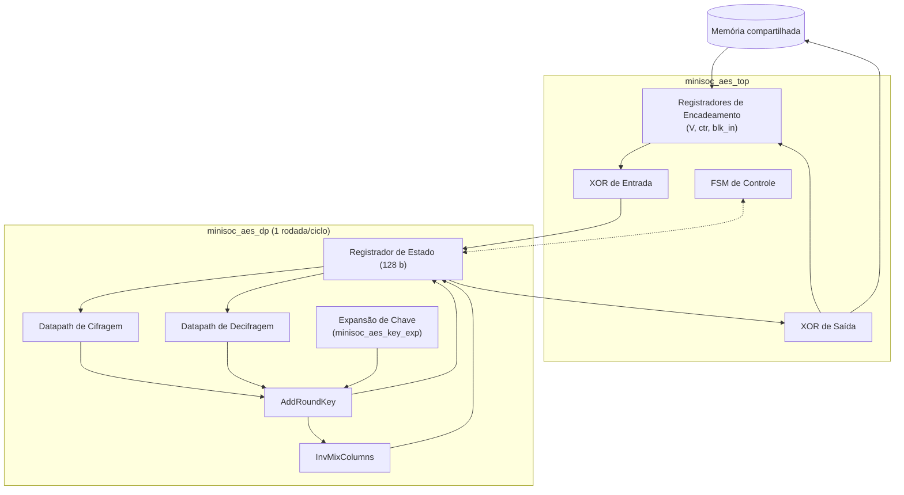
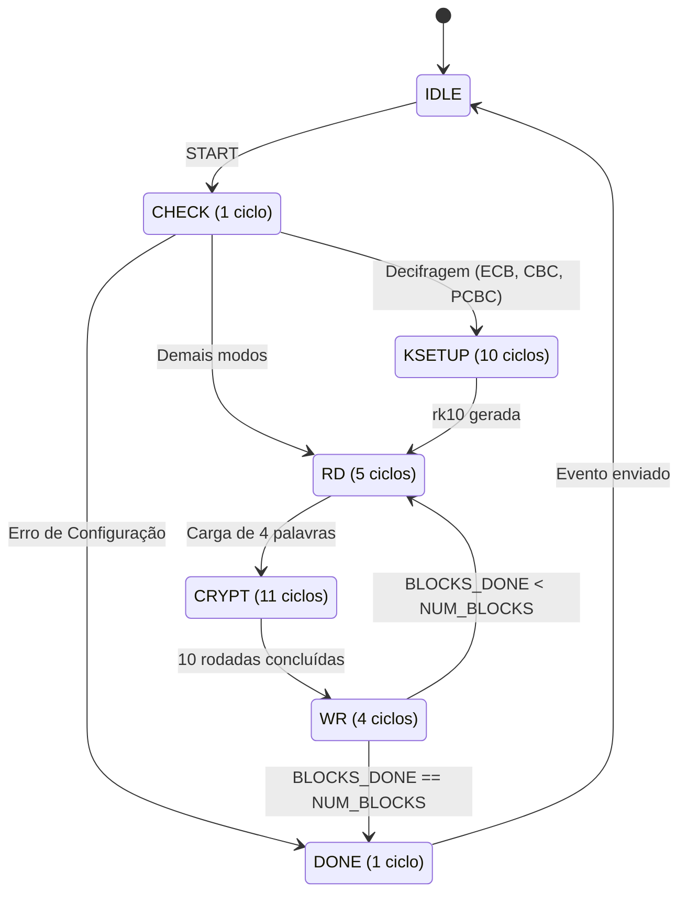

# MiniSoC AES — Microarquitetura v1.0

**Referência:** Block Guide MiniSoC AES v1.0.0 · FIPS-197

Este documento especifica a implementação dos módulos `minisoc_aes_top` e `minisoc_aes_dp`. As interfaces de topo, mapa de registradores e o protocolo SPI seguem estritamente o Block Guide.

## 1. Decisões

| Tema | Decisão | Alternativa descartada |
|---|---|---|
| Microarquitetura do AES | **Iterativa, uma rodada por ciclo**: um só estado de 128 bits e uma só lógica de rodada, reutilizada nas 10 rodadas | Desenrolada (10 rodadas combinacionais): mais rápida por bloco, mas com ~10× a lógica de rodada e um caminho crítico ~10× mais longo, o que limitaria a frequência de `sys_clk`. Datapath de 32 bits: menor, mas pelo menos 4× mais ciclos de cálculo |
| Decifragem | **Cifra inversa direta** : InvShiftRows → InvSubBytes → AddRoundKey → InvMixColumns. Usa as round keys como estão, e os valores do Apêndice C.1 conferem rodada a rodada | Cifra inversa equivalente : estrutura igual à da cifragem, mas exige InvMixColumns nas round keys |
| Round keys | **Em tempo real**, uma por ciclo, no `minisoc_aes_key_exp`, que sabe andar nos dois sentidos | Guardar as 11 round keys (1408 flops): elimina o passo inverso, mas custa área e potência |
| Modos de operação | Encadeamento fora do datapath: `minisoc_aes_top` faz as XORs de entrada e de saída; `minisoc_aes_dp` só cifra ou decifra um bloco | Modos dentro do `dp` |
| Registradores de status | `BUSY`, `DONE`, `ERROR` e o valor final de `BLOCKS_DONE` ficam no domínio **clk** (always-on) | Ficar no domínio `sys_clk`: o status seria apagado se o PLL fosse desligado depois do término |
| CDC | Toggle + 2 flops para eventos, Gray + 2 flops para o contador, quasi-estático para a configuração | |

## 2. Domínios de Clock

O sistema opera sobre quatro domínios de clock independentes:
- **`spi_sclk` (até 25 MHz):** Recepção do quadro SPI e deslocamento do MISO.
- **`clk` (2 GHz, always-on):** Decodificação SPI, banco de registradores, status, PLL mock, sincronizadores e controle de reset.
- **`sys_clk` (PLL, 250 MHz a 2 GHz):** Lógica principal (`minisoc_aes_top`, `minisoc_aes_dp` e `minisoc_aes_key_exp`).
- **`mem_clk` (até 200 MHz):** Interface MEMORY DATA, ativa quando o usuário externo detém o controle da memória. (A seleção de clock é feita via multiplexador estático).

## 3. Microarquitetura do Motor AES

O datapath é segmentado entre o controle de modos (no topo) e o núcleo de processamento AES, conforme o fluxo abaixo:

### 3.1 Registradores de Encadeamento
Para suportar os diferentes modos de operação, o módulo `minisoc_aes_top` mantém os seguintes registradores:
- **`V` (128 bits):** Acumulador de vetor de inicialização ou bloco de feedback.
- **`ctr` (64 bits):** Contador incrementado por bloco para o modo CTR.
- **`blk_in` (128 bits):** Registrador de retenção do bloco original lido da memória, necessário para modos que requerem feedback do texto original após a decifragem (ex: CBC, CFB).

### 3.2 Operações por Ciclo do Datapath
O índice `r` (1 a 10) controla as rodadas, processando uma operação completa por ciclo de `sys_clk`. A chave inicial (`rk0` ou `rk10`) é combinada via XOR no ciclo de carregamento.

| Sentido | Rodadas 1 a 9 | Rodada 10 (Final) |
|---|---|---|
| **Cifragem** | `state ← AddRoundKey(MixColumns(ShiftRows(SubBytes(state))), rk[r])` | Desvio combinacional: ignora `MixColumns` |
| **Decifragem** | `state ← InvMixColumns(AddRoundKey(InvSubBytes(InvShiftRows(state)), rk[10−r]))` | Desvio combinacional: ignora `InvMixColumns` |

### 3.3 Interface do Datapath (`minisoc_aes_dp`)
Sinais de interface definidos para o submódulo:
*   **Entradas:** `clk_i`, `rst_n_i`, `key_load_i`, `decrypt_i`, `key_i[127:0]`, `blk_start_i`, `blk_i[127:0]`
*   **Saídas:** `key_ready_o`, `blk_o[127:0]`, `blk_done_o`, `busy_o`

**Modos.** `minisoc_aes_top` monta a entrada do `dp` e trata a saída. `V` guarda IV e encadeamento. `E` e `D` são a cifragem e a decifragem de um bloco.

| MODE | Primitiva | Entrada do `dp` | Saída gravada na memória | Próximo `V` |
|---|---|---|---|---|
| 000 ECB | E ou D | bloco lido | saída do `dp` | |
| 001 CBC | E ou D | cifra: `P ^ V`; decifra: `C` | cifra: `E(...)`; decifra: `D(C) ^ V` | `C` (o texto cifrado do bloco) |
| 010 PCBC | E ou D | cifra: `P ^ V`; decifra: `C` | cifra: `E(...)`; decifra: `D(C) ^ V` | `P ^ C` |
| 011 CFB | sempre E | `V` | `bloco ^ E(V)` | `C` |
| 100 OFB | sempre E | `V` | `bloco ^ E(V)` | `E(V)` |
| 101 CTR | sempre E | `V ^ {64'b0, ctr}` | `bloco ^ E(...)` | `V` fixo; `ctr + 1` |

Duas consequências para a RTL. Como o resultado é gravado **no lugar**, `C` precisa ser guardado antes de ser sobrescrito: por isso existe `blk_in`, que alimenta `V` na decifragem de CBC, PCBC e CFB. E o sentido inverso só é exigido em ECB, CBC e PCBC.

## 4. FSM do Controlador `minisoc_aes_top`

A máquina de estados orquestra a leitura da SRAM, o processamento de blocos e a reescrita *in-place*. 

| Estado | O que faz |
|---|---|
| **IDLE** | Aguarda o evento de START. |
| **CHECK** | Valida a configuração (`MODE ≤ 101`, `1 ≤ NUM_BLOCKS ≤ 256`). Emite o sinal de carregamento de chave. |
| **KSETUP** | Expansão prévia até a rodada 10 (exclusivo para decifragem em ECB/CBC/PCBC). Ocorre apenas 1 vez por operação. |
| **RD** | Lê 4 palavras (endereços `base` a `base+3`). Monta o estado `blk_in`. |
| **CRYPT** | Executa o XOR de entrada, as 10 rodadas ativas iterativas e o XOR de saída. |
| **WR** | Grava o resultado de 128 bits *in-place* na memória. Atualiza `V`, `ctr`, endereço base e `BLOCKS_DONE`. |
| **DONE** | Dispara o pulso sincronizado de conclusão ou erro. |

## 5. Clock Domain Crossing (CDC)

| Sinal / Barramento | Cruzamento | Técnica de Sincronização |
|---|---|---|
| **Comandos SPI** | `spi_sclk` → `clk` | Toggle event + 2 FFs |
| **Leitura (MISO)** | `clk` → `spi_sclk` | Sinal quasi-estático (estável 1 quadro antes da leitura) |
| **START** | `clk` → `sys_clk` | Toggle + 2 FFs |
| **DONE / ERROR** | `sys_clk` → `clk` | Toggle + 2 FFs |
| **BLOCKS_DONE** | `sys_clk` → `clk` | Codificação Gray (9 bits) + 2 FFs |
| **Configuração** | `clk` → `sys_clk` | Quasi-estático (amostrado estavelmente no estado CHECK) |

## 6. Sequência de Reset

O sistema possui uma hierarquia de reset baseada no sinal global `rst_n`:
1. **`rst_ctrl_n` (domínio `clk`):** Reset assíncrono e liberação síncrona (2 FFs). Atua no banco de registradores SPI e na configuração do PLL.
2. **`rst_sys_n` (domínio `sys_clk`):** Reset sincronizado dependente da estabilidade do PLL.

**Fluxo de inicialização do domínio do sistema:**
1. Quando `rst_n = 0`, os domínios `clk` e `sys_clk` entram em reset imediatamente.
2. O software assere `PLL_ENABLE = 1`.
3. O sinal `pll_locked` sobe, liberando o clock de sistema (`sys_clk`).
4. Um sincronizador de 4 estágios atrasa a subida de `rst_sys_n` até que o clock esteja perfeitamente limpo, retirando a FSM do estado de reset de forma síncrona e segura. Se `pll_locked` cair, `rst_sys_n` é imposto novamente de forma assíncrona.
